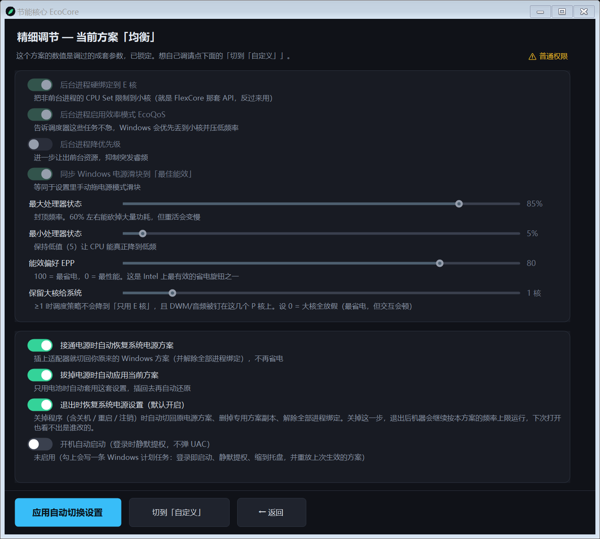
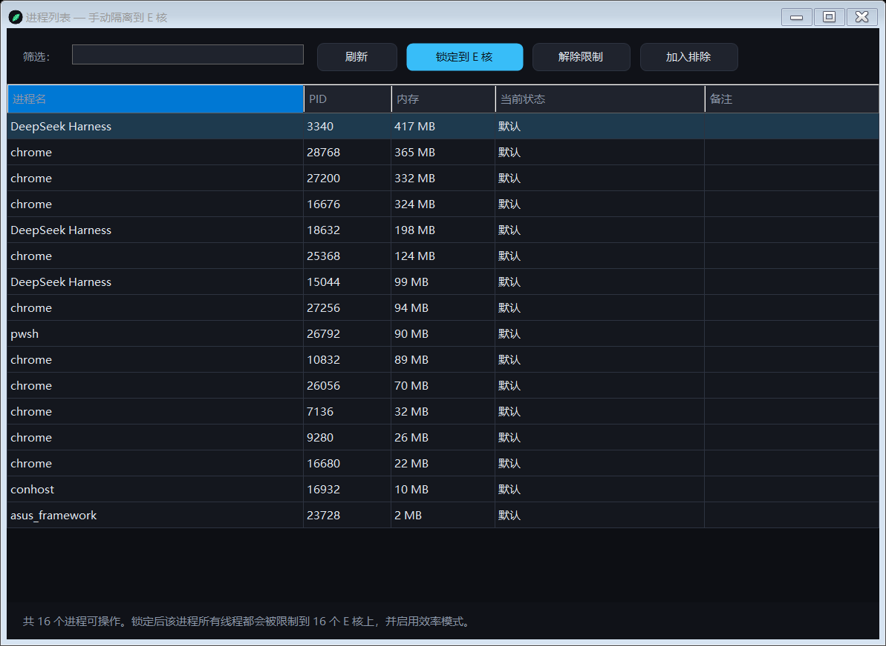

# EcoCore — 大小核笔记本续航优化器

给 **Intel 大小核（P 核 + E 核）/ AMD 混合架构** 笔记本用的省电工具。

核心思路和 FlexCore 的「核心动态隔离」正好相反：FlexCore 把游戏钉到大核上换帧数，
**EcoCore 把后台压到小核、留一个大核给系统、再收紧 CPU 的功耗上限**，换来续航。

> 实测机型：Intel Core Ultra 9 290HX Plus = **8 P 核 + 16 E 核，24 个 CPU Set，单 Group**


| 精细调节（同一窗口的二级界面） | 进程列表 |
|---|---|
|  |  |

---

## 下载

到 [Releases](../../releases/latest) 下载 **`EcoCore.exe`**（单文件，约 50 MB，自带 .NET 运行时，不用另装任何东西）。
不想见到 SmartScreen 拦截的，也可以下载 **`EcoCore-win-x64.zip`**（45 MB，解压后直接跑）。

双击运行 → UAC 点「是」→ 选方案 → 点「应用当前方案」。

- 单文件、自包含，Win10 2004+ / Win11，x64
- 免安装，删掉 exe 就干净了（配置在 `%ProgramData%\EcoCore\`，可手动删）
- 只改自己复制出来的电源方案副本，**原方案一个字节都不动**，退出/点「恢复默认」自动还原

### 第一次双击被 SmartScreen 拦住（蓝屏「Windows 已保护你的电脑」）

这是**没买代码签名证书**的必然结果，不是杀毒软件报毒 —— 提示里那句「发布者未知」说的就是它：

> Microsoft Defender SmartScreen 阻止了无法识别的应用启动　应用：EcoCore.exe　发行者：发布者未知

微软官方的推荐路径是「先提交、等信誉」，但对个人开源工具最省事的处理是这几种，任选：

| 做法 | 操作 | 效果 |
| --- | --- | --- |
| **点「仍要运行」** | 对话框里直接点右下角 | 本次能跑；下次还可能拦 |
| **去掉 Internet 标记**（推荐） | 把仓库里的 [`解除阻止.cmd`](解除阻止.cmd) 丢到 exe 同目录双击；或右键 exe → 属性 → 勾选「解除锁定」→ 确定 | 永久生效，之后双击不再被拦 |
| 命令行 | `Unblock-File -LiteralPath .\EcoCore.exe` | 同上，一行搞定 |
| 自己有证书 | `signtool sign /fd sha256 /f cert.pfx /p 密码 EcoCore.exe` | 换台机器也认可，但 SmartScreen 仍要看证书信誉 |

原理：从浏览器下载的文件会被写上一个 NTFS 备用数据流 `Zone.Identifier`（`ZoneId=3` = 来自 Internet）。
SmartScreen 对「无签名 + 有该标记」的文件一律拦；把这个标记去掉，它当场就认。

#### 想让「别人下载后也不用点任何东西」：只有两种办法

| 办法 | 成本 | 是否对任何人都零提示 |
| --- | --- | --- |
| **发 zip 包**（本仓库已经在发 `EcoCore-win-x64.zip`） | 免费 | 基本是。zip 解压出来的文件**不带** Internet 标记，SmartScreen 不会拦 —— 实测 `Expand-Archive` / `ZipFile.ExtractToDirectory` / 7-Zip 解出的文件流都只有 `:$DATA`。唯一例外：用资源管理器右键「全部解压缩」，它会把标记一起搬过去 |
| **代码签名证书** | 自签名免费但无效；OV 约 ¥1000+/年（仍要攒信誉）；**EV 约 ¥3000+/年（唯一立即放行）** | EV 是；OV 要等信誉 |
| Microsoft Store 上架 | $19 一次性 | 是（商店包由微软签名，不过要走 MSIX 打包） |
| 提交微软建信誉 | 免费 | 不是「任何人」，且信誉绑文件哈希，重新编译就清零 |

现实结论：**免费方案里，zip 分发能让绝大多数人拿到「双击就跑、什么都不用点」的体验**，这也是本仓库同时发 exe 和 zip 的原因。

---

## 它到底改了什么

四层，从「进程级」到「CPU 全局」逐层收：

### 第 1 层：EcoQoS（进程级节流）

`SetProcessInformation(ProcessPowerThrottling)` 给进程打 `EXECUTION_SPEED` 标记。调度器会主动把这些进程往 E 核赶，并且不给它们升频机会。最温和的一层，进程还能跑满一个小核。

### 第 2 层：CPU Set 硬绑定（进程级钉核）

`SetProcessDefaultCpuSets` / `SetThreadSelectedCpuSets` 把进程的 CPU Set 集合改成那 16 个 E 核。
和 `SetProcessAffinityMask` 的区别：CPU Set 是 Win10 1709 之后为大小核架构准备的机制，能跨 Group、调度器能正确理解，不会把进程和大核的 DPC 搅在一起。

> **踩坑记录（很重要）**：`SetProcessDefaultCpuSets` 要的访问权是 `PROCESS_SET_LIMITED_INFORMATION`（**0x2000**），
> 不是 `PROCESS_SET_INFORMATION`（0x0200）。只给 0x0200 时 `OpenProcess` 直接返回 `ERROR_ACCESS_DENIED (5)`。
> 实测对照：`mask=0x0200 → err=5`，`mask=0x2000 → OK`。
> 而 0x2000 **不需要管理员权限** —— 所以绑核这一层不依赖提权。

本机 E 核 CPU Set ID：

```
258 259 260 261 262 263 264 265 270 271 272 273 274 275 276 277
```

P 核 CPU Set ID：

```
256 257 266 267 268 269 278 279
```

### 第 3 层：优先级压制

后台进程降到 `BELOW_NORMAL_PRIORITY_CLASS`。配合前两层，前台只要有一点活，后台立刻让路。

### 第 4 层：电源方案（全局，需管理员）

用 `PowerDuplicateScheme` 复制一份当前方案（**不动原方案**），在副本里写：

| 设置 | GUID | 作用 |
|---|---|---|
| `SCHEDPOLICY` 异构调度策略 | `93b8b6dc-0698-4d1c-9ee4-0644e900c85d` | 4 = 首选高效处理器（把活往 E 核推） |
| `SHORTSCHEDPOLICY` 短线程调度策略 | `bae08b81-2d5e-4688-ad6a-13243356654b` | 同上 |
| `PERFEPP` 能效偏好 | `36687f9e-e3a5-4dbf-b1dc-15eb381c6863` | 100 = 最省电（默认 50） |
| `PROCTHROTTLEMAX` 最大处理器状态 | `bc5038f7-23e0-4960-96da-33abaf5935ec` | 60~85 = 砍掉睿频上限 |
| `PERFBOOSTMODE` 睿频模式 | `be337238-0d82-4146-a960-4f3749d470c7` | 0 = 关睿频 |
| `CPMINCORES` / `CPMAXCORES` 核心停泊 | `0cc5b647-c1df-4637-891a-dec35c318583` / `…584` | 允许 Windows 停掉空闲核 |
| 电源滑块 overlay | `961cc777-2547-4f9d-8174-7d86181b8a7a`（最佳能效） | 联动 Windows 自带滑块 |

> `SCHEDPOLICY` 取值（本机实测）：`0`=所有处理器 `1`=高性能处理器 `2`=首选高性能处理器 `3`=高效处理器 `4`=首选高效处理器 `5`=自动

**回滚**：软件退出 / 点「恢复默认」时切回原方案，并删除自己复制的方案副本。原方案从头到尾没被改过一个字节。

---

## 五个方案（前四个锁定，第五个自定义）

| 方案 | 最大处理器状态 | EPP | 异构策略 | 停核 | 保留大核 | 适合 |
|---|---|---|---|---|---|---|
| 极致省电 | 60% | 100 | 首选高效核 | 20 / 60 | 1 | 纯文档、看视频、挂机下载 |
| 均衡 | 85% | 80 | 首选高效核 | 30 / 80 | 1 | 日常办公 |
| 轻度 | 95% | 60 | 自动 | 不启用 | 2 | 编译、轻度游戏 |
| 性能 | 100% | 50 | 自动 | 不启用 | 0 | 打游戏、跑分，等于什么都没改 |
| 自定义 | 你定 | 你定 | 由数值反推 | 关 | 你定 | 想自己调参的人 |

**锁定规则**：选中前四个方案时，精细调节页里的 4 个勾选项和 4 个滑块全部灰显、点不动、拖不动。
这几个方案的数值是调过的成套参数，随手改一个（比如把「极致省电」的频率上限拉到 100%）就自相矛盾了，
所以锁死，避免「我明明选了省电怎么还这么热」。

**只有「自定义」可编辑**：切到自定义后所有控件解锁，改动**立刻存盘**（`settings.json` 的 `CustomProfile` 节点），
切到别的方案再切回来不会丢。两个「自动切换」开关属于全局行为，任何方案下都能动。

---

## 「精细调节」是同一窗口里的二级界面

主界面只留 **拓扑图 + 五个方案 + 执行日志 + 底部按钮**，调参的东西放下一级页面。
**不是弹出新窗口** —— 点「打开…」当前窗口整个换成精细调节页，点「← 返回」换回来：

```
主页面（1193×862）                     二级界面（1193×924，同一个窗口）
┌────────────────────────────┐        ┌────────────────────────────┐
│ 拓扑图（哪些核在省电）       │        │ 精细调节 — 当前方案「X」     │
│ 五个方案按钮                 │ 打开…  │ ┌ 参数卡片 ─────────────┐ │
│ 方案说明                     │ ────→ │ │ 4 开关 + 4 滑块        │ │
│ ┌ 精细调节 ─────── [打开…] ┐ │        │ └───────────────────────┘ │
│ │ 当前方案「X」参数已锁定… │ │  ←返  │ ┌ 自动切换 ─────────────┐ │
│ └─────────────────────────┘ │ ←────  │ │ 2 开关（永不锁）       │ │
│ 执行日志                     │        │ └───────────────────────┘ │
│ [应用] [恢复] [进程] [托盘]  │        │ [应用并生效 / 切自定义] [返回] │
└────────────────────────────┘        └────────────────────────────┘
```

实现方式是把二级界面做成一个 `UserControl`（`DetailPage`），盖在主界面之上，主界面的 `_root` / `_footer` 整体隐藏：

```csharp
// 进二级界面：同一个窗口内换页，顺手把窗口撑到装得下
_mainPageHeight = Height;
_root.Visible = false;
if (_footer != null) _footer.Visible = false;

_detailPage.Bounds = new Rectangle(0, 0, ClientSize.Width, ClientSize.Height);
_detailPage.OpenProfile(_working);                          // 先摆一次，量出内容高度

var wa = Screen.FromControl(this).WorkingArea;
int want = _detailPage.DesiredHeight + (Height - ClientSize.Height);
if (want > Height) Height = Math.Min(want, wa.Height - Px(8));

_detailPage.Bounds = new Rectangle(0, 0, ClientSize.Width, ClientSize.Height);
_detailPage.OpenProfile(_working);                          // 尺寸变了，重新摆一次
_detailPage.Visible = true;
_detailPage.BringToFront();

// 返回：还原主页面和原来的窗口高度
private void CloseDetailPage()
{
    if (_detailPage != null) _detailPage.Visible = false;
    _root.Visible = true;
    if (_footer != null) _footer.Visible = true;
    if (_mainPageHeight > 0) Height = _mainPageHeight;
    LayoutChrome();
    _root.Focus();
}
```

要点：

- **一个窗口，两次高度**。进二级界面窗口从 862 长到 924，返回时恢复原高度（`_mainPageHeight` 记着）。
- **页面内滚到底栏固定**。`DetailPage` 自己也是 `_root`(AutoScroll) + `_footer` 两段式，底栏永远贴窗口底。
- **改完不点「应用」等于没改**。二级界面用 `_working.Clone()`，点「← 返回」直接丢弃。
- **应用后自动回主页面**：`OnDetailApplied` 末尾调 `CloseDetailPage()`。

数据流只有一条线（`MainForm._working` 是唯一数据源）：

```csharp
private void OnDetailApplied(EcoProfile p)
{
    _working = p.Clone();
    _st.CurrentProfile = p.Clone();
    _st.ActiveProfileName = p.Name;
    if (p.IsCustom) _st.CustomProfile = p.Clone();
    StateStore.Save(_st);
    LoadProfileIntoUi(p);
    DoApply();                           // 立刻生效
    CloseDetailPage();                   // 应用完自动回主页面
}
```

**踩过的坑**：`EcoProfile.ThrottleMax / ThrottleMin / PerfEpp` 是 `uint`，而 `EcoSlider.Value` 是 `int`，
直接赋值编译不过（`error CS0266`），必须显式转换并配 `Math.Clamp` 兜住范围。
另外 `UserControl` 里别把方法叫 `Enter` —— 会撞上 `Control.Enter` 事件（`warning CS0108`）。

---

## 「保留大核给系统」——这是重点

把后台全赶到 E 核之后有个副作用：DWM（桌面合成）、`audiodg`（音频引擎）、中断/DPC 全挤在小核上，
结果就是 **鼠标拖窗口掉帧、放歌爆音、打字有延迟**。

所以默认 **保留 1 个 P 核给系统**：

1. 取 `PerformanceCores.OrderBy(CoreIndex).Take(n)` —— 也就是 LP0/LP1 那一片。
   Windows 本来就把内核线程、DPC、时钟中断压在 LP0 上，保留这片最不打扰调度。
2. 当保留数 ≥ 1 时，异构调度策略最多只放到 `4`（首选高效核）而不是 `3`（只用高效核）。
   `3` 会把 P 核饿死，系统线程被强行塞进 E 核，那是真的卡。代码里用
   `EcoProfile.EffectiveSchedPolicy` / `EffectiveShortSchedPolicy` 强制 `Math.Min(SchedPolicy, 4)` 兜住。
3. `dwm` 和 `audiodg` 用 `SetProcessDefaultCpuSets` 单独钉到被保留的 P 核上。
   界面顶部小方块网格里，**紫色格子就是给系统留的大核**。

滑块拉到 0 = 一个大核都不留（更省电，但动画明显变涩），拉到 2 = 多留一个。

---

## 快速开始

```
双击 EcoCore.exe → UAC 点「是」 → 选方案 → 应用
```

**进程层（CPU Set 绑定 + EcoQoS）不需要管理员权限**，只有电源层
（`PowerDuplicateScheme` / `PowerWrite*` / `PowerSetActiveOverlayScheme`）要。
非管理员启动时程序会明确提示「跳过电源策略层，进程层照常生效」，不是什么都不做。

**权限状态一眼可见**：标题右端有权限胶囊 —— 绿色 `✓ 管理员` / 黄色 `⚠ 普通权限`，
「精细调节」页面右上角同样标一个；启动日志里也会写明当前这一档能改什么。
（实现：`MainForm.PaintHeader` 里的 `_isAdmin` 徽章 + `Coordinator.IsElevated()`）

**插电 / 电池自动切换**：默认开启，两个独立开关（改了立刻存盘，不用点「应用」）：

| 开关 | 触发 | 动作 |
|---|---|---|
| 接通电源时自动恢复系统电源方案 | 检测到插上适配器 | 切回**系统原有电源方案**、删除专用方案副本、解除全部进程绑定、清掉 EcoQoS，等于一键还原 |
| 拔掉电源时自动应用当前方案 | 检测到拔掉适配器 | 自动套用**你当前选中的方案**（上次用哪个就套哪个，不写死「均衡」） |

实现细节（`Coordinator.Restore` + `MainForm.OnTick`，2 秒轮询 `GetSystemPowerStatus`）：

- 只在 AC/电池状态**变化**的那一次触发，不会反复刷
- 还原前先比对「当前激活方案是不是我们那份副本」：你自己在 Windows 设置里换过方案，程序不会硬切回去覆盖你的选择
- 插电还原时同时解除 CPU Set 绑定与 EcoQoS，进程立刻恢复全核自由调度
- 两个开关都关掉，程序就只在你手点「应用」时动一次

**关闭窗口 = 最小化到托盘**，右键托盘图标可以「恢复默认并退出」——退出时一定还原电源方案。

### 退出时恢复系统电源设置（默认开启）

关掉程序就算「退出」：**退出、关机、重启、注销，都会先恢复电源设置再走**——
切回原电源方案、删掉「EcoCore 节能」副本、解除全部进程的 E 核绑定与 EcoQoS。

```
退出流程（MainForm.OnFormClosing）
  1. _co.Restore()        → 切回 OriginalSchemeGuid、删除专用副本、电源滑块回「最佳性能」
  2. if 开机自启仍启用    → _st.Applied = true（保住"下次登录要重放"的意图，否则退一次自启就永久失效）
```

为什么要默认做这件事：专用电源方案副本是**持久化**的。留在系统里的话，下次开机会觉得
「怎么这么省电 / 怎么这么慢」，而且根本看不出是谁改的。退出还机器一个原样最省心。

「精细调节」里可以关掉（`退出时恢复系统电源设置`）。关掉后退出只解除进程绑定、电源方案继续生效——
适合「我就要它一直生效」的用法，代价是得自己记得手动还原。

> 早期版本是弹一个「要不要恢复电源方案？」的三选对话框，现在改成默认直接恢复、不再问。

### 开机自动启动

「精细调节」窗口里第三个开关：**开机自动启动（登录时静默提权，不弹 UAC）**。

勾上后程序会写一条 **Windows 计划任务**（`EcoCore AutoStart`），不是注册表 Run 项，原因是
本程序的清单是 `requireAdministrator`：

| 方式 | 登录时权限 | 弹 UAC | 电源层能否生效 |
|---|---|---|---|
| **计划任务 + `/rl highest`**（默认走这条） | 管理员 | 不弹 | ✅ 全部功能 |
| 注册表 `HKCU\...\Run`（没权限时的退路） | 普通用户 | 不弹 | ❌ 只有进程层 |

没拿到管理员权限时勾这个开关，程序会**降级到注册表 Run 项并当场告诉你**「登录后电源层不会生效，
请以管理员身份重新打开本程序再勾一次」——不会假装成功。开关状态永远以磁盘上的真实情况为准
（在别处手建/手删过任务，打开界面就会显示实际是什么），提示文字用颜色区分：
绿=计划任务、黄=注册表退路、灰=未启用。

自启动拉起时带两个参数：

```
EcoCore.exe --tray --resume
```

- `--tray`：直接缩到托盘，不弹主窗口
- `--resume`：**按上次使用的方案重新应用一次**。进程的 E 核绑定和 EcoQoS 都不跨重启保留，
  开机只把图标挂到托盘里而不重放，等于什么都没做。上次退出时没在生效状态，就不自动应用

### 「上次用的模式」是怎么记住的

不是靠退出时保存，而是**每次动作立刻落盘**（`settings.json`），断电 / 强杀 / 关机流程没走完也不会丢：

| 时机 | 写入什么 |
|---|---|
| 点方案按钮（`LoadProfileIntoUi`） | `ActiveProfileName` + `CurrentProfile` |
| 点「应用当前方案」/ 自启重放（`DoApply`） | 同上，另把自定义方案存进 `CustomProfile` |
| 精细调节「应用并生效」（`OnDetailApplied`） | 同上 |

启动时按 `ActiveProfileName == "自定义" ? CustomProfile : CurrentProfile` 还原，所以：

- 上次选「极致省电」并应用 → 开机自启重放的是**极致省电**，不是默认的「均衡」
- 上次在「自定义」里调过参数 → 重放的还是你那套参数
- 上次选「性能」→ 重放「性能」（自启不等于强制省电，按你最后的选择来）

命令行等价物（排障用，非管理员也能查）：

```
EcoCore.exe --autostart status     # 模式: ScheduledTask / RunKey / None
EcoCore.exe --autostart on         # 优先建计划任务，失败退注册表
EcoCore.exe --autostart off        # 删任务 + 清 Run 项
```

---

## 进程隔离页

「进程列表…」按钮打开。列出所有进程的 PID、内存占用、是否已在 E 核、是否有 EcoQoS。
可以单独对某个进程做：锁到 E 核 / 解除限制 / 加入排除列表。排除列表里的进程永远不会被动——比如你自己的游戏、编译器、OBS。

> 系统关键进程（`dwm` `audiodg` `explorer` `svchost` `csrss` `smss` `lsass` 等 40 多个）
> 硬编码在 `ProcessEngine.ProtectedNames` 里，即使你想锁也锁不了。

---

## 数据与文件位置

| 内容 | 路径 |
|---|---|
| 配置 | `%ProgramData%\EcoCore\settings.json`（无权限时回退 `%LocalAppData%\EcoCore\`） |
| 日志 | `%ProgramData%\EcoCore\ecocore.log` |
| 自检报告 | 程序目录 `selftest.log` |

`settings.json` 记了 `OriginalSchemeGuid` 和 `EcoSchemeGuid`。就算软件崩了没来得及还原，
把 `OriginalSchemeGuid` 用 `powercfg /setactive` 设回去就行：

```powershell
powercfg /list
powercfg /setactive 27fa6203-3987-4dcc-918d-748559d549ec
```

---

## 自己验证 / 排障

**端到端实测**（起一个记事本当探针 → 真跑一遍 Apply → 读回探针 CPU Set → Restore）：

```powershell
dotnet src\EcoCore\bin\x64\Release\net10.0-windows\EcoCore.dll --applytest
# 结果看同目录 applytest.log
```

非管理员实测输出：

```
拓扑: 混合架构：8 个 P 核（EfficiencyClass=1） + 16 个 E 核（EfficiencyClass=0），共 24 个 CPU Set
探针: notepad.exe
应用前探针 CPU Set: 全部（未限制）
Apply([均衡]) → True
⚠ 非管理员运行：跳过电源策略层（频率上限 / 睿频 / EPP 不生效），进程层照常生效
保留大核 CPU Set = [256]
后台进程：CPU Set 绑定 18 个，效率模式 18 个
应用后探针 CPU Set: [258, 259, 260, 261, 262, 263, 264, 265, 270, 271, 272, 273, 274, 275, 276, 277]
[PASS] 探针已被限制在 E 核内
[PASS] 已解除绑定
```

**无界面自检**（六段：拓扑 → 电源读取 → 电池 → 电源写入实测 → 进程 CPU Set 实测 → DWM 钉核实测）：

```powershell
EcoCore.exe --selftest          # 提权运行，结果看程序目录 selftest.log
```

其他调试参数：`--smoke`（建窗渲染一帧就退）、`--shot <png>` / `--shot3 <png>`（截图排版）、
`--detail`（启动即进二级界面）、`--profile <名字>`（强制启动方案）。

---

## 从源码构建

要求：**Windows x64 + .NET 10 SDK**（`dotnet --list-sdks` 应能看到 `10.0.x`）。无第三方依赖。

```powershell
# 1. 普通构建（产物在 src\EcoCore\bin\x64\Release\net10.0-windows\）
pwsh -File build.ps1

# 2. 单文件自包含发布（产物在 release\EcoCore.exe，约 50 MB）
pwsh -File publish.ps1
```

> 若 `%USERPROFILE%\.dotnet` 不可写（受限环境），两个脚本已把 `DOTNET_CLI_HOME` / `NUGET_PACKAGES` 指到工程目录内。

## 源码结构

```
src/EcoCore/
  Native/Win32.cs        P/Invoke：CPU Set、EcoQoS、PowerWrite、电池
  Core/CpuTopology.cs    GetSystemCpuSetInformation 枚举 P/E 核
  Core/PowerTuner.cs     电源方案复制/读写/还原
  Core/ProcessEngine.cs  EcoQoS、CPU Set 绑定、优先级
  Core/Profiles.cs       预设方案 + 配置持久化
  Core/Coordinator.cs    串起四层，负责应用/还原/自动切换
  UI/Theme.cs            暗色主题 + 自绘控件 + 拓扑网格
  UI/MainForm.cs         主界面
  UI/DetailPage.cs       精细调节（同一窗口的二级界面）
  UI/ProcessForm.cs      进程列表
  Program.cs             入口 + 自检 + 冒烟 + 截图
```

目标框架 `net10.0-windows`，x64，WinForms，零第三方依赖。

---

## 实测数据汇总（Intel Core Ultra 9 290HX Plus）

```
CPU Set 数 24，单 Group，8 P + 16 E，无超线程
P 核（EfficiencyClass=1）: #256 LP0:0  #257 LP0:1  #266 LP0:10 #267 LP0:11
                          #268 LP0:12 #269 LP0:13 #278 LP0:22 #279 LP0:23
E 核（EfficiencyClass=0）: #258..265 LP0:2..9   #270..277 LP0:14..21

原方案 27fa6203-3987-4dcc-918d-748559d549ec (Performance)
  SCHEDPOLICY 5 / SHORTSCHEDPOLICY 5 / PERFBOOSTMODE 2
  PROCTHROTTLEMAX 100 / PROCTHROTTLEMIN 5 / PERFEPP 50
  CPMINCORES AC=75 DC=25 / CPMAXCORES 0
```

注意 P 核**不在 LP 连续区段**（LP2-LP9、LP14-LP21 是 E 核），所以任何「按 LP 序号猜大小核」的写法都会错，
必须读 `EfficiencyClass`。这也是为什么代码坚持用 `GetSystemCpuSetInformation`。

---

## 省电效果实测（自己量的，有原始数据）

测法：ACPI 直读电池放电功率（`BatteryMeter`），**配对 A/B** —— 每轮交替跑「原样 → EcoCore」共 3 轮，
抵消机器发热造成的漂移；每阶段稳定 20 s 后连续采 75 s，2 秒一个点。全程电池供电、亮度固定 51%。

**轻负载（2 个忙循环进程，模拟写代码时的索引/编译，CPU 10~12%）**

| 回合 | 原样 | EcoCore 极致省电 | 差值 |
| --- | --- | --- | --- |
| 1 | 25978 mW | 13556 mW | −47.8% |
| 2 | 31093 mW | 11744 mW | −62.2% |
| 3 | 37024 mW | 11827 mW | −68.1% |
| 平均 | **31365 mW** | **12376 mW** | **−60.5%** |

**CPU 占用率两边一样（10~12%），做同样多的活，功耗差六成。** 82 Wh 电池估算 2.61 h → 6.63 h。

**空闲（不额外加负载，CPU 4.5~4.8%）**：11.09 W 对 11.10~11.36 W，**没有差别** —— 机器没事可做时它不会乱动。

为什么差这么多：Windows 会把「有点忙」的进程丢给 P 核，而 P 核在移动端为了单核性能把频率冲到最高，
**两颗 P 核就能吃掉 30 W 以上**；EcoCore 把这些进程的 CPU Set 限制到 E 核并打上 EcoQoS，
同样的活由 E 核以低得多的功耗完成。

### 但前提是：别把系统自己的省电模式关掉

同一台机器、同样 2 线程轻负载，把厂家自带的**省电模式关掉**再测一遍（方案仍是 Silent、亮度 51%、电池放电）：

| 场景 | 原样 | EcoCore（仅进程层） | 降幅 |
| --- | --- | --- | --- |
| 省电模式开 | 31.4 W | 12.4 W | **−60.5%** |
| 省电模式关 | 42.5 W | 36.2 W | **−14.9%** |

- 原样功耗整体抬高 **35%**（31.4 → 42.5 W）：没有 EC / 系统的频率上限，2 个线程也能把封装推到 42 W
- 只靠进程层时收益从 −60% 掉到 **−15%**：系统限频消失后，把线程挪到 E 核省下的只是 P/E 能效差本身
- 也就是说，**关掉省电模式的状态下，真正的主力是电源层（频率上限 / 睿频 / EPP），而它必须管理员权限**

自己复现：

```powershell
# 轻负载，3 轮配对
EcoCore.exe --bench --ab --profile maxsaving --rounds 3 --seconds 75 --settle 20 --load 2 --out bench\admin-maxsaving

# 空闲对照
EcoCore.exe --bench --ab --profile maxsaving --rounds 3 --seconds 75 --settle 20 --out bench\admin-idle

# 一次对比多个方案（均衡 / 极致 / 轻度）
EcoCore.exe --bench --ab --profiles balanced,maxsaving,light --rounds 2 --seconds 75 --settle 20 --load 2 --out bench\admin-profiles

# 只看当前电池状态
EcoCore.exe --battery

# 读某个进程真实的 CPU Set / EcoQoS（验证绑核到底有没有落地）
EcoCore.exe --pidinfo <pid>
```

手工验证与应用：

```powershell
EcoCore.exe --pinall      # 按「极致省电」钉住所有后台进程并保持
EcoCore.exe --unpinall    # 清除所有进程的 CPU Set 绑定、关掉 EcoQoS、还原电源方案
```

产物：`meta.txt`（环境快照 + 进程表）、`samples.csv`（逐点原始数据，含当时前台应用与窗口标题）、
`summary.txt`（配对对比 + 续航估算）、`processes-before.csv`。
上面这组数据的完整报告见仓库里的 `bench/报告.md`。

---

## 兼容性：它怎么自动认 CPU

**没有任何硬编码的核号列表。** 每次启动现场探测，换一台机器直接能用：

1. `GetSystemCpuSetInformation` 枚举所有 CPU Set（Win10 2004+ 的接口，不需要管理员）
2. 按 `EfficiencyClass` 分组：**值最大的那组 = P 核，值最小的那组 = E 核**
3. 两组都存在 → `IsHybrid = true`，绑核功能启用
4. 只存在一个值（老双核/四核、只有超线程、或虚拟机的 vCPU）→ `IsHybrid = false`，
   **进程绑核自动跳过**，只应用电源方案层，界面上明确打一行提示
5. CPU 型号从 `HKLM\HARDWARE\DESCRIPTION\System\CentralProcessor\0\ProcessorNameString` 读，显示在「执行日志」第一行

| 平台 | 探测结果 | 行为 |
|---|---|---|
| Intel 12~14 代 / Core Ultra（大小核） | P 核 `EfficiencyClass=1`，E 核 `=0` | 全功能 |
| Intel 11 代及更早（全 P 核） | 单一 `EfficiencyClass` | 只做电源方案层 |
| AMD Zen 4 / Zen 5（含 Zen4c） | Windows 同样按 0/1 报 | 全功能 |
| AMD 老 Zen / 纯 SMT | 单一 `EfficiencyClass` | 只做电源方案层 |
| 多 Group（>64 逻辑核） | CPU Set ID 全局唯一 | 正常，无需额外处理 |
| 虚拟机 | 通常无 CPU Set 差异 | 只做电源方案层 |

判断逻辑在 `src/EcoCore/Core/CpuTopology.cs:96`（`Discover()`）与 `:41`（`IsHybrid` / `SupportsIsolation`），
绑核入口在 `src/EcoCore/Core/ProcessEngine.cs:191`，非混合架构时直接返回「本机不是大小核架构，无法隔离」。

---

## 许可证

[MIT](LICENSE)
