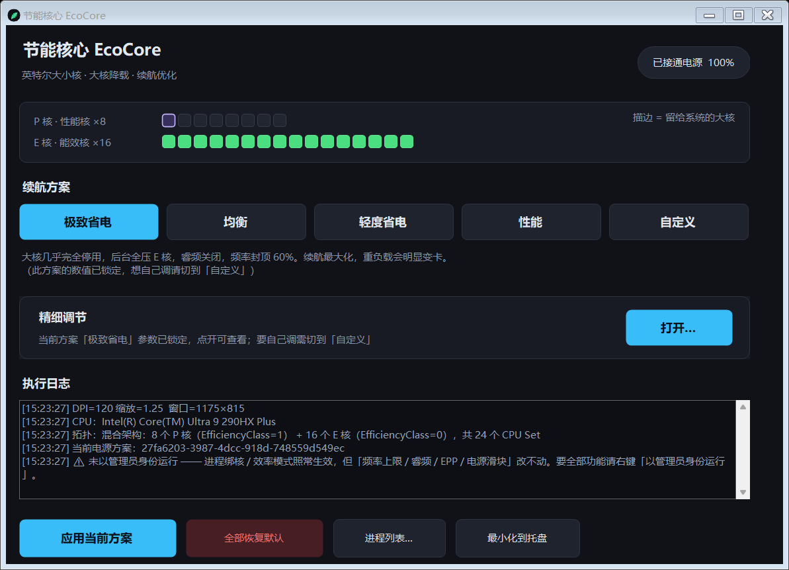

# EcoCore — 大小核笔记本续航优化器

给 **Intel 大小核（P 核 + E 核）/ AMD 混合架构** 笔记本用的省电工具。

想法很简单：Windows 会把"有点忙"的后台进程丢给 P 核，而移动端的 P 核为了单核性能会把频率拉到顶，
**两颗 P 核就能吃掉 30 W 以上**。EcoCore 把这些活压到 E 核上、再收紧 CPU 的功耗上限——
同样多的活，用更少的电做完。

---

## 效果



同一台机器、同样的活，**轻负载（2 线程，模拟写代码时的索引 / 编译，CPU 占用 10~12%）**：

| 状态 | 放电功率 | 82 Wh 电池估算续航 |
| --- | --- | --- |
| 原样（只开着厂家省电模式） | 31.4 W | 约 2.6 小时 |
| 开 EcoCore「极致省电」 | **12.4 W** | **约 6.6 小时** |

**降幅 60.5%，CPU 占用率两边完全一样（10~12%）** —— 不是少干活，是把活挪到更省电的核上。
连续 3 轮配对测试（每轮交替跑"原样 → EcoCore"，抵消发热漂移）：

| 回合 | 原样 | EcoCore | 差值 |
| --- | --- | --- | --- |
| 1 | 25978 mW | 13556 mW | −47.8% |
| 2 | 31093 mW | 11744 mW | −62.2% |
| 3 | 37024 mW | 11827 mW | −68.1% |
| **平均** | **31365 mW** | **12376 mW** | **−60.5%** |

四个方案横向对比（提权，每阶段稳定 20 s + 连续采 75 s）：

| 方案 | 放电功率 | 相对原样 | 续航（82 Wh） |
| --- | --- | --- | --- |
| 原样 | 31.3 W | — | 2.6 h |
| 均衡 | 11.3 W | −63.8% | 7.3 h |
| **极致省电** | **10.7 W** | **−65.8%** | **7.5 h** |
| 轻度省电 | 14.3 W | −54.4% | 5.8 h |

> 极致省电和均衡只差 0.6 W（E 核本身的频率范围就窄，再压上限拉不开差距），
> 但均衡留了约 40% 的性能余量。**日常用「均衡」，出门前换「极致省电」。**

### 它平时几乎不干事

机器闲着（CPU 4.5%）时，开不开 EcoCore 都是 **11.1 W**，没有区别 —— 没有可压的活，它不会乱动。
真正省电发生在"有点忙但不需要全速"的场景：后台索引、下载、网页、文档、聊天软件。

### 前提：别把系统自己的省电模式关掉

同一台机器、同样 2 线程负载，把厂家自带的省电模式**关掉**再测：

| 场景 | 原样 | EcoCore | 降幅 |
| --- | --- | --- | --- |
| 系统省电模式开 | 31.4 W | 12.4 W | **−60.5%** |
| 系统省电模式关 | 42.5 W | 36.2 W | **−14.9%** |

关掉系统省电模式后，原样功耗整体抬高 35%（没有 EC / 系统的频率上限，2 个线程就能把封装推到 42 W）。
此时只靠"把进程挪到 E 核"还能再省 15%，剩下的大头要靠电源方案层（频率上限 / 睿频 / EPP）——
**那一层必须管理员权限**。所以：系统省电模式 + EcoCore 一起用，效果最好。

---

## 对日常使用的实际影响

- **前台几乎感觉不到。** 你正在用的窗口、游戏、播放视频都不在压制范围内（只在后台进程上生效）
- **性能损失可控。** 「均衡」留了足够余量，办公、网页、1080p 视频、轻度代码编译都无感；
  真要跑重活就切「性能」或把编译器加进排除列表
- **进程列表里能单个放行。** 打开进程页可以把某个程序钉到 E 核 / 解除限制 / 永久排除
- **退出就还原。** 关掉程序（含关机 / 重启 / 注销）会自动切回原电源方案、删掉自己建的副本、
  解除全部进程绑定 —— 不会在你机器上留一堆看不出是谁改的设置
- **不写注册表垃圾。** 免安装，删掉 exe 就干净了；配置在 `%ProgramData%\EcoCore\`，可手删

---

## 下载

到 [Releases](../../releases/latest) 下载：

| 文件 | 说明 |
| --- | --- |
| **`EcoCore-win-x64.zip`**（推荐） | 45 MB，解压后直接跑。解出来的文件不带 Internet 标记，**SmartScreen 不会拦** |
| `EcoCore.exe` | 单文件版，50 MB，自带 .NET 运行时。直接双击可能被拦一次，点「仍要运行」即可 |

双击 → UAC 点「是」→ 选方案 → 点「应用当前方案」。Win10 2004+ / Win11，x64，不用另装任何东西。

**需要管理员权限的两件事**：频率上限、睿频、EPP、电源滑块。
**不需要管理员也生效的**：把后台进程钉到 E 核、效率模式、降优先级。程序界面右上角会标明当前是哪一档
（`✓ 管理员` / `⚠ 普通权限`），不会让你以为改了其实没改。

<details>
<summary><b>第一次双击被 SmartScreen 拦住（蓝屏「Windows 已保护你的电脑」）</b></summary>

这是**没买代码签名证书**的必然结果，不是杀毒软件报毒——提示里那句「发布者未知」说的就是它。

| 做法 | 操作 | 效果 |
| --- | --- | --- |
| 点「仍要运行」 | 对话框右下角 | 本次能跑，下次还可能拦 |
| **去掉 Internet 标记**（推荐） | 双击仓库里的 `解除阻止.cmd`；或右键 exe → 属性 → 勾「解除锁定」 | 永久生效 |
| 命令行 | `Unblock-File -LiteralPath .\EcoCore.exe` | 同上 |
| 直接下 zip 包 | 解压出来的文件没有该标记 | 根本不会拦 |

原理：浏览器下载文件会写一个 NTFS 备用数据流 `Zone.Identifier`（`ZoneId=3` = 来自 Internet）。
SmartScreen 对「无签名 + 有该标记」的文件一律拦；把标记去掉它就认。

</details>

---

## 它到底改了什么

四层，从进程级到 CPU 全局逐层收，全部可回滚：

| 层 | 手段 | 作用范围 | 要管理员吗 |
| --- | --- | --- | --- |
| 1 | **EcoQoS**（`SetProcessInformation` 的 `EXECUTION_SPEED`） | 单进程 | 不要 |
| 2 | **CPU Set 硬绑定**（把进程限制到 E 核的 CPU Set） | 单进程 | 不要 |
| 3 | **降优先级**（`BELOW_NORMAL`） | 单进程 | 不要 |
| 4 | **电源方案**（复制一份当前方案，在副本里写频率上限 / 睿频 / EPP / 调度策略，再激活） | 全系统 | 要 |

第 4 层特别说明：EcoCore **只改自己复制出来的副本**，原方案一个字节都不动；
退出或点「恢复默认」时切回原方案并删掉副本。

> 为什么用 CPU Set 而不是 `SetProcessAffinityMask`：CPU Set 是 Win10 1709 之后为大小核架构准备的机制，
> 能跨 Group、调度器能正确理解，不会把进程和大核的 DPC 搅在一起。

---

## 五个方案

前四个是调好的成套参数，**建议直接用**；想自己动参数就切到「自定义」，改完自动记住。

| 方案 | 最大处理器状态 | 能效偏好 EPP | 异步调度 | 保留大核 | 适合 |
| --- | --- | --- | --- | --- | --- |
| 极致省电 | 60% | 100 | 首选高效核 | 1 | 纯文档、看视频、挂机下载 |
| 均衡 | 85% | 80 | 首选高效核 | 1 | 日常办公（推荐） |
| 轻度省电 | 95% | 60 | 自动 | 2 | 编译、轻度游戏 |
| 性能 | 100% | 50 | 自动 | 0 | 跑重活、插电用 |
| 自定义 | 自己定 | 自己定 | 自己定 | 自己定 | 你清楚自己在调什么 |

**「保留大核给系统」是个关键设计**：至少留 1 个 P 核不被压制，桌面合成（DWM）和音频引擎
（audiodg）还钉在这几个核上。否则 DWM 被挤到 E 核，窗口拖动和视频播放会明显卡、音频会爆音。
设成 0 = 大核全放假（最省电，但交互会顿）。

---

## 自动行为

| 行为 | 触发 | 动作 |
| --- | --- | --- |
| 插电还原 | 检测到插上适配器 | 切回系统原方案、删副本、解除全部绑核 |
| 拔电应用 | 检测到拔掉适配器 | 自动套用**当前选中的方案**（上次用哪个就套哪个） |
| 退出还原 | 退出 / 关机 / 重启 / 注销 | 同上，还机器一个原样 |
| 开机自启 | 登录时（可选，默认关） | 静默提权启动、缩到托盘、**按上次使用的方案**重新应用 |

开机自启用的是 **Windows 计划任务**（带 `/rl highest`）而不是注册表 Run 项：
本程序清单要求管理员，Run 项只能拿普通令牌，每次开机还得让人点 UAC，电源层全改不动。
拿不到权限时会降级到 Run 项并当场说明「登录后电源层不会生效」，不假装成功。

> ⚠ **一处致命默认值**：`schtasks /create` 生成的任务默认带
> `DisallowStartIfOnBatteries=true` / `StopIfGoingOnBatteries=true`，也就是「只有接着电源才启动」。
> 对笔记本来说这意味着**拔了电源开机，自启根本不会跑**（任务状态 Ready、`Last Result=267011`
> 「尚未运行」）。所以这里不用 schtasks 的默认模板，而是自己写任务 XML 把这两个开关关掉，
> 并加 10 秒延迟避开登录瞬间的磁盘争抢。老版本建的任务会在下一次以管理员身份启动时自动重建。

自检命令：`EcoCore.exe --autostart status` 会把任务里真正决定「会不会启动」的开关全打出来
（运行级别 / 延迟 / 电池时是否禁止启动 / 切电池是否停止 / 执行时限 / 实际命令）；
`--autostart test` 立刻触发一次任务，用来验证这条路真的通。

---

## 兼容性：它怎么认 CPU

**没有任何硬编码的核号列表**，每次启动现场探测：

1. 用 `GetSystemCpuSetInformation` 枚举全部 CPU Set（Win10 2004+，不需要管理员）
2. 按 `EfficiencyClass` 分组：**值最大的那组 = P 核，值最小的那组 = E 核**
3. 两组都存在 → 启用绑核；只有一个值 → 自动跳过绑核，只做电源方案层，界面上明确提示

| 平台 | 探测结果 | 行为 |
| --- | --- | --- |
| Intel 12~14 代 / Core Ultra（大小核） | P=1 / E=0 | 全功能 |
| Intel 11 代及更早（全大核） | 单一 `EfficiencyClass` | 只做电源方案层 |
| AMD Zen 4 / Zen 5（含 Zen4c） | 同样按 0/1 报 | 全功能 |
| AMD 老 Zen / 纯 SMT | 单一 `EfficiencyClass` | 只做电源方案层 |
| 多 Group（>64 逻辑核） | CPU Set ID 全局唯一 | 正常 |
| 虚拟机 | 通常无 CPU Set 差异 | 只做电源方案层 |

测试机（Intel Core Ultra 9 290HX Plus）上 P 核在 LP0/1、LP10~13、LP22/23，中间夹着 E 核段——
所以**不能按 LP 序号猜大小核**，必须读 `EfficiencyClass`。

---

## 常见问题

**会不会让我电脑变卡？**
前台窗口不受影响。后台进程被压到 E 核后，重活会慢一点——这正是省电的来源。
觉得慢就切「均衡 / 轻度省电」，或把那个程序加进排除列表。

**和厂家自带的省电模式（ASUS / 联想 / 戴尔的控制中心）冲突吗？**
不冲突，而且是**叠加**的。但别把厂家的省电模式关掉——实测关掉后本工具收益从 −60% 掉到 −15%。

**游戏能用吗？**
不建议。它的方向是把活往小核推，游戏要的是大核满血——那种需求请用「性能」方案或直接关掉本工具。
同类工具里 FlexCore 走的是相反方向（把游戏钉在大核上），两者思路不同。

**会不会改坏系统？**
它只改自己复制出来的那份电源方案，原方案不碰；退出/关机时自动切回并删除副本。
真出问题：`powercfg /list` 看一眼，手动 `powercfg /delete <GUID>` 删掉 `EcoCore 节能` 即可。

**后台常驻耗电吗？**
几乎不。空闲时它只在 2 秒一次的定时器里读一次电池状态，实测开不开都是 11.1 W。

**双击后提示「应用程序启动异常」/ 一闪就没了？**
先看程序目录下的 `crash.log` 和 `boot.log`，那里有真正的异常栈。已知的一种：
WinForms 的 `Application.EnableVisualStyles()` 会先往 `%TEMP%` 写一份激活上下文清单，写不进去就抛
`UnauthorizedAccessException`，进程在 `Main` 里直接死掉——用户只看到系统那句毫无信息量的
「应用程序启动异常」。1.2.5 起会在启动时探测 `%TEMP%` 可写性，不可写就自动切到
`%LOCALAPPDATA%\EcoCore\tmp`；仍然失败也只降级成「无视觉样式」，不会退出（界面本来就是自绘的）。

---

## 自己复现测量

内置了测量工具：ACPI 直读电池放电功率，配对 A/B（每轮交替跑"原样 → EcoCore"，抵消发热漂移）：

```powershell
# 轻负载，3 轮配对
EcoCore.exe --bench --ab --profile maxsaving --rounds 3 --seconds 75 --settle 20 --load 2 --out bench\my-test

# 一次对比多个方案
EcoCore.exe --bench --ab --profiles balanced,maxsaving,light --rounds 2 --seconds 75 --settle 20 --load 2 --out bench\my-3profiles

# 只看当前电池状态
EcoCore.exe --battery

# 读某进程真实的 CPU Set / EcoQoS（验证绑核到底有没有落地）
EcoCore.exe --pidinfo <pid>
```

产物：`summary.txt`（配对对比 + 续航估算）、`samples.csv`（逐点原始数据，含当时前台应用与窗口标题）、
`meta.txt`（环境快照）、`processes-before.csv`（进程基线）。

上面所有数字的完整报告（含 4 组对照、原始数据、失败与作废的回合）见 [`bench/报告.md`](bench/报告.md)。
测量方法的一点说明：**必须提权测**，否则电源层被跳过、数据没有意义；**采样期间不要跑别的分析命令**，
那会污染数据（我们踩过，某一轮空闲测试直接飙到 19 W，只好作废）。

---

## 从源码构建

要求：**Windows x64 + .NET 10 SDK**（`dotnet --list-sdks` 能看到 `10.0.x`）。零第三方依赖。

```powershell
pwsh -File build.ps1      # 普通构建
pwsh -File publish.ps1    # 单文件自包含发布 → release\EcoCore.exe + zip
```

```
src/EcoCore/
  Native/Win32.cs        P/Invoke：CPU Set、EcoQoS、PowerWrite、电池
  Core/CpuTopology.cs    枚举 P/E 核（GetSystemCpuSetInformation）
  Core/PowerTuner.cs     电源方案复制 / 读写 / 还原
  Core/ProcessEngine.cs  EcoQoS、CPU Set 绑定、优先级
  Core/Profiles.cs       预设方案 + 配置持久化
  Core/Coordinator.cs    串起四层，负责应用 / 还原 / 自动切换
  Core/AutoStart.cs      开机自启（计划任务优先，注册表回退）
  Core/Bench.cs          功耗测量（配对 A/B）
  Core/BatteryMeter.cs   ACPI 电池直读
  UI/                    自绘暗色界面（WinForms + GDI+）
  Program.cs             入口 + 自检 / 冒烟 / 截图 / bench
```

目标框架 `net10.0-windows`，x64，WinForms，C# 13。

---

## 许可证

[MIT](LICENSE)

> 本项目与 FlexCore / LaoYing Optimizer 无任何关联。思路来自对"核心动态隔离"的反向使用：
> 它把游戏钉到大核换帧数，这里把后台压到小核换续航。
